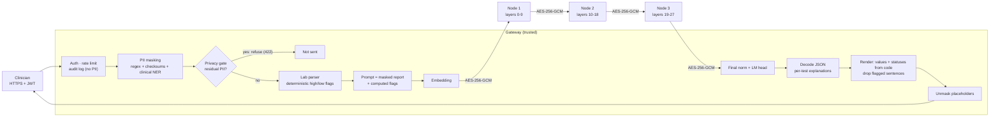

# secure-clinical-llm

[](https://github.com/yagmurtncr/secure-clinical-llm/actions/workflows/tests.yml)


**A privacy-preserving LLM assistant that explains Turkish lab reports, with the model split across several
on-premise machines.** Patient identifiers are removed before the model sees the text, no machine other than
the gateway ever sees tokens or output, and every answer is checked against the report before it is returned.
Every claim below is backed by a test or a reproducible experiment, including the ones that show where the
design stops protecting you.

> Hospitals cannot send patient data to a cloud LLM, and they rarely have one GPU large enough for a 7-8B
> model. This project runs a strong open model (default: Qwen2.5-7B-Instruct) across ordinary machines, keeps
> identifiers inside a trusted gateway, and measures what that costs.

## How a request flows



<sub>Layer ranges shown for Qwen2.5-7B (28 layers, 3 nodes). The gateway relays the hidden state to each node in turn.</sub>

## Design decisions

| Decision | Why |
|---|---|
| **Gateway keeps embedding and LM head; nodes hold only middle layers** | No node ever sees token ids or logits. This is *not* confidentiality on its own: experiment 3 shows hidden states can be read back almost completely. |
| **Each node loads only its own tensors from safetensors** | A 3-node deployment needs ~1/3 of the weights per machine; nothing is unpickled. |
| **Per-node KV cache, keyed by session** | Decoding is incremental (O(1) new token per step per node) instead of re-running the whole prompt. |
| **Authenticated X25519 handshake + AES-256-GCM with counters** | Fresh keys per channel, tamper detection, replay and reflection rejection, and rogue machines without the cluster secret are refused. |
| **PII masked *before* embedding, restored *after* decoding** | Because hidden states are invertible (measured below), identifiers must never enter the model. Placeholders like `[AD_1]` survive generation and are mapped back at the gateway. |
| **Lab flags computed in code and given to the model** | The model explains; it does not do range arithmetic. The ablation below measures the effect. |
| **Structured answers: the model explains, the code renders** | The model returns JSON with one explanation per test; the value, range and high/low status shown to the patient come from the lab parser, so they cannot be hallucinated. Explanation sentences the checker flags are removed (section 8). |
| **Grounding check on every answer** | Flags numbers that are not in the report and high/low statements that contradict the reference range. |
| **Fail-closed privacy gate** | Because nodes can read hidden states back (section 3) and noise does not fix that (section 9), masking is the guarantee. A second, recall-first scan of the masked text refuses to send anything that still looks like PII (section 7). |

Full threat model, including what this design does **not** protect against: [docs/THREAT_MODEL.md](docs/THREAT_MODEL.md).

## Results

All numbers below are reproducible with the scripts in [`eval/`](eval/); raw outputs are in [`results/`](results/).

### 1. Split inference is exact

The split pipeline is tested against the monolithic model for Llama and Qwen2 architectures with 1-3 shards:
logits match to 1e-5 and greedy outputs are token-identical, both in-process and over the encrypted HTTP
transport ([`tests/test_split.py`](tests/test_split.py), [`tests/test_transport.py`](tests/test_transport.py)).

### 2. PII detection

Exact-span precision / recall / F1, 95% bootstrap CI over reports. Two synthetic sets: the **standard** set
(500 lab reports, 3,148 identifiers, with hard negatives such as invalid 11-digit barcodes and device serials
that look like phone numbers) and a **stress** set (300 reports, 995 identifiers) built from formats the
detector was not designed around: unseen field labels, upper / lower-case names, "Sayın ..." salutations,
spaced ID numbers, identifiers inside running sentences, relatives named only in free text.

| Set | Regex + validators | + Turkish BERT NER |
|---|---|---|
| Standard, micro F1 | 0.975 [0.971, 0.978] | **0.997 [0.996, 0.999]** |
| Standard, names (`AD`) recall | 0.890 | 0.989 |
| Stress, micro F1 - *first run* | 0.532 [0.508, 0.558] | - |
| Stress, micro F1 - after fixes | 0.870 [0.861, 0.880] | **0.987 [0.979, 0.993]** |
| Stress, names (`AD`) recall - after fixes | 0.558 | 0.965 |

T.C. Kimlik No, phone, e-mail, IBAN, record numbers and birth dates are at 1.000 precision and recall on the
standard set. The stress set did its job: its first run exposed spaced ID numbers (recall 0.49), unseen labels
(`İsim:`, `Adı:`), salutations and upper-case names; the fixes (grouped-ID pattern with checksum, new labels,
salutation rule, Turkish case-folded propagation of a found name to the rest of the report) took regex-only F1
from 0.53 to 0.87. Names that appear only in free text still need the NER model.
*Caveat:* both sets are synthetic and written by the author of the detector; treat them as regression tests
and an upper bound, not as performance on real hospital reports.

```bash
python eval/pii_benchmark.py --n 500 [--ner]                 # standard
python eval/pii_benchmark.py --n 300 --hard --seed 3 [--ner] # stress
```

### 3. How much does a curious node see? (hidden-state leakage)

A node receives hidden states, not text. How much text can it reconstruct? Qwen2.5-0.5B-Instruct (24 layers),
token recovery accuracy on 40 held-out reports (11,567 tokens). The attacker trains a ridge regression from
hidden state to input embedding on 100 reports it generated itself; **train and test use disjoint name lists**,
so the name column measures names the attacker has never seen.

| Hidden state after layer | Nearest embedding, no training (all tokens) | Linear probe (all tokens) | Linear probe (unseen name tokens) |
|---|---|---|---|
| 0 (raw embedding) | 1.000 | 0.993 | 0.842 |
| 1 | 0.001 | 0.975 | 0.418 |
| 4 | 0.000 | 0.973 | 0.373 |
| 8 (shard boundary) | 0.000 | 0.972 | 0.358 |
| 16 (shard boundary) | 0.000 | 0.973 | 0.388 |
| 23 | 0.001 | 0.963 | 0.273 |

**A simple linear attacker reads back ~97% of the report from any node, at any depth**, and about a third of the
tokens of names it never trained on. Splitting the model is a deployment measure (pool small GPUs, no node
holds tokens or answers), not a privacy mechanism. This is the measured reason the design masks identifiers
*before* embedding and treats nodes as trusted on-premise infrastructure; see the
[threat model](docs/THREAT_MODEL.md).

```bash
python eval/hidden_state_leakage.py --model Qwen/Qwen2.5-0.5B-Instruct --train 100 --test 40
```

### 4. Cost of splitting and encryption

Crypto micro-benchmark (pack + encrypt + decrypt + unpack, bf16 activations):

| Hidden size | One decode step | 512-token prefill |
|---|---|---|
| 3,584 (Qwen2.5-7B) | 0.017 ms (7 KB) | 2.5 ms (3.7 MB) |
| 4,096 (Llama-3.1-8B) | 0.016 ms (8 KB) | 2.8 ms (4.2 MB) |

End-to-end, Qwen2.5-0.5B-Instruct, 3 shards, 128-token prompt, 48 new tokens, 2-core CPU:

| Setup | Tokens / s |
|---|---|
| Monolithic `model.generate` | 9.6 |
| Split, in-process | 9.8 |
| Split, 3 HTTP nodes on localhost, encrypted | 8.4 (+17 ms / token) |

Encryption is negligible; the overhead is HTTP round trips (3 per token). A persistent binary stream
(gRPC / WebSocket) is the obvious next optimization.

```bash
python eval/split_overhead.py --model Qwen/Qwen2.5-0.5B-Instruct
```

### 5. Can the grounding checker be trusted?

Before using the checker as a metric, it was tested on answers with known injected errors (400 reports,
`eval/checker_validation.py`). Paraphrases are split into a *dev* set (used once to extend the keyword list)
and a *held-out* set written beforehand and never used for tuning.

| | Flagged |
|---|---|
| Correct answers (false positives), all phrasings | **0.0 %** |
| Invented number | 99.0 % |
| Wrong high/low claim, standard phrasing | 100 % |
| Wrong claim, dev paraphrases | 3.5 % → 78.2 % after extending the lexicon |
| Wrong claim, held-out paraphrases | **0 %** |

The checker never raises false alarms and reliably catches invented numbers, but a keyword lexicon does not
generalize to unseen phrasings: a contradiction worded differently goes unnoticed. Results in section 6
therefore count only claims the checker can parse. Section 8 removes the dependence on the checker for the
status line itself; an NLI-based checker for free wording is still open.

### 6. Do computed flags reduce hallucination? (ablation)

Same pipeline, same 50 synthetic reports, with and without the computed-flags table in the prompt
(Qwen2.5-1.5B-Instruct on CPU, greedy decoding, 160 new tokens). 95% intervals from a paired bootstrap over
reports (`results/grounding_qwen1.5b_cpu_n50.json`).

| | With computed flags | Without (model reads ranges itself) |
|---|---|---|
| Wrong high / low / normal claims | **0 / 130** (≤ 2.3 %, rule of three) | 8 / 22 = 36 % [29 %, 50 %] |
| Checkable status claims per answer | **2.6** [2.1, 3.1] | 0.44 [0.14, 0.78] |
| Answers containing a number not in the report | 6 % [0 %, 14 %] | 18 % [8 %, 30 %] |

What the data supports: with the flags the model states a status for ~6x more results and none of those
statements is wrong; without them, about a third of the few statements it makes are wrong. The drop in
invented numbers points the same way but is **not significant at n = 50** (difference -12 points,
CI [-26, +2]). Two caveats: the checker only parses standard phrasings (section 5), and at 1.5B the model
partly restates the flags table, so this measures the guard, not explanation quality. The 7B GPU run is the
next step.

```bash
python eval/grounding_eval.py --model Qwen/Qwen2.5-7B-Instruct --n 50 --device cuda
```

### 7. Making masking the guarantee: clinical NER fine-tune + fail-closed gate

Sections 3 and 9 show that whatever enters the model can be read back by a node, so the question that matters
for privacy is: **how often does an identifier reach the nodes unmasked?** To measure it honestly, a new
generator ([`src/scllm/pii/synthetic.py`](src/scllm/pii/synthetic.py)) writes clinical documents from
*template families* (lab headers, discharge summaries, consult notes, referral letters for training; nursing
notes, phone-call logs and ward handover tables held out) with names from *disjoint pools*, Turkish case
suffixes with vowel harmony ("Öztürk'ün", "Koç'tan"), upper / lower case, titles and relatives.

The base Turkish NER model was fine-tuned on 2,000 training-family documents on CPU (1 epoch, 15 min,
[`scripts/train_ner.py`](scripts/train_ner.py)), with whole-document upper/lower-casing as augmentation because
the cased base model missed lower-case names. Results on 1,000 held-out documents (unseen families, unseen
names; [`results/pii_heldout.json`](results/pii_heldout.json)):

| Gateway configuration | Name recall | PII characters masked | Documents leaking ≥1 identifier [95% CI] | Refused by gate |
|---|---|---|---|---|
| Regex + validators | 0.000 | 16.6 % | 100 % | - |
| + base Turkish NER | 0.988 | 99.54 % | 2.0 % [1.3, 3.1] | - |
| + base NER + gate | 0.993 | 99.95 % | 0.4 % [0.2, 1.0] | 1.6 % |
| + **clinical NER (fine-tuned)** | **1.000** | **100 %** | **0 %** [0, 0.38] | - |
| + clinical NER + gate | 1.000 | 100 % | 0 % [0, 0.38] | 0 % |

The gate re-runs NER on the *masked* text at a low confidence threshold (0.30), looks for any validated ID,
phone or e-mail and any 10-11 digit run outside a placeholder, and refuses the request if it finds one
([`src/scllm/pii/gate.py`](src/scllm/pii/gate.py)); the API answers 422 and the audit log records only the
finding labels. With the base model it turned 20 leaky documents into 4, at a cost of refusing 1.6 %. A list of
titles (Dr., Hemş., Bey, Hanım...) that the gate must not count as names was added after inspecting its
refusals on this set; that is the only design decision informed by held-out data.

**What the perfect score does and does not mean.** Train and test come from the same author and the same kind
of generator, so 0 leaks out of 1,000 says the fine-tune learned these formats and generalizes across
families and names, not that real hospital text is solved. Two checks against overfitting to the generator:
on real Wikipedia sentences (WikiANN Turkish test, 1,000 sentences, 452 names), person-name F1 is 0.705 vs
0.724 for the base model (recall 0.772 vs 0.777), a small loss in precision and no collapse
([`results/ner_real_text.json`](results/ner_real_text.json)); and the older stress set from section 2 goes from
0.987 to 0.999 micro F1 (its name lists overlap the training pool, so this is a regression check only).
Fine-tuned weights are not committed (440 MB); `scripts/train_ner.py` reproduces them on a laptop CPU.

```bash
python scripts/train_ner.py --n 2000 --out models/ner-clinical-tr
python eval/pii_heldout.py --n 1000 --configs regex+ner,regex+ner+gate,regex+ner_ft,regex+ner_ft+gate
python eval/ner_real_text.py --n 1000
```

### 8. Structured answers: statuses come from code

In structured mode ([`src/scllm/clinical/structured.py`](src/scllm/clinical/structured.py)) the model returns
`{"ozet", "testler": [{"test", "aciklama"}], "oneri"}`. The gateway renders the answer itself: every line's
value, reference range and status is taken from the lab parser; the model's text is attached as an
explanation only after sentences with invented numbers or a contradicting direction word are removed. If the
JSON is cut off by the token limit, completed test objects are kept; if nothing parses, the answer is the
computed table alone. A unit test feeds an adversarial output (a low value described as "yüksek") and checks
that the patient sees "Düşük" and never the false sentence.

Same 12 reports, Qwen2.5-1.5B-Instruct on CPU, 384 new tokens ([`results/structured_vs_free.json`](results/structured_vs_free.json)):

| | Free text (with flags) | Structured |
|---|---|---|
| JSON parsed (incl. truncated-output salvage) | - | 12 / 12 |
| Answers with a contradiction the checker finds | 0 / 12 | 0 / 12 |
| Answers with an invented number | 0 / 12 | 0 / 12 |
| Abnormal tests mentioned | 100 % | 100 % (by construction) |
| Sentences removed by the gateway | - | 2 |

At this size and n, both modes are already clean on what the checker can see, so this is **not** a measured
improvement; the value of structured mode is a guarantee that does not depend on the checker's recall (which is
0 % on unseen paraphrases, section 5). The run also showed the limit of a 1.5B model: its "explanations" mostly
echoed the flags line, so the renderer now drops such echoes instead of printing them twice. Explanation
quality needs the 7B run.

### 9. Does noise on the hidden states help? (privacy-utility curve)

The gateway adds Gaussian noise, scaled to each token's hidden-state RMS, to what it sends to the first node.
The attacker knows the noise level and trains its probe on noisy states. Qwen2.5-0.5B-Instruct, 60 training
and 30 held-out documents (unseen families and names), boundary after the embedding (k = 0) or after two
gateway-held layers (k = 2); [`results/noise_defense.json`](results/noise_defense.json):

| k | Noise σ | Probe: all tokens | Probe: unseen names | Nearest embedding, no training | Top-1 agreement with clean model | Perplexity × |
|---|---|---|---|---|---|---|
| 0 | 0 | 0.84 | 0.66 | 1.00 | 1.00 | 1.0 |
| 0 | 0.25 | 0.84 | 0.65 | 1.00 | 0.78 | 1.1 |
| 0 | 1 | 0.80 | 0.55 | 1.00 | 0.30 | 6.9 |
| 0 | 4 | 0.54 | 0.14 | 0.99 | 0.02 | 311 |
| 2 | 0 | 0.82 | 0.57 | 0.00 | 1.00 | 1.0 |
| 2 | 0.25 | 0.81 | 0.57 | 0.00 | 0.78 | 1.1 |
| 2 | 1 | 0.76 | 0.42 | 0.00 | 0.36 | 3.6 |
| 2 | 4 | 0.47 | 0.05 | 0.00 | 0.07 | 1003 |

There is no useful operating point: noise small enough to keep the model working (σ = 0.25 already changes
22 % of next-token predictions) leaves recovery almost untouched, and noise large enough to hide names makes
the output meaningless. At k = 0 even σ = 4 leaves the training-free nearest-embedding attack at 99 %, because
in 896 dimensions the true token stays the closest of 152k candidates. This is why the design relies on
masking plus the gate (section 7) and treats nodes as trusted on-premise machines, rather than on perturbing
activations. (Recovery numbers here are lower than in section 3 because the probe is trained on 60 instead of
100 documents and tested on different document types.)

```bash
python eval/noise_defense.py --boundary 0 2 --sigmas 0 0.25 1 4 --train 60 --test 30
```

## Quick start

**Single machine** (the model is split into shards in-process, full gateway pipeline):

```bash
pip install -e ".[test]"
python examples/demo_local.py --model Qwen/Qwen2.5-7B-Instruct --device cuda --ner
python examples/demo_local.py --model Qwen/Qwen2.5-1.5B-Instruct --dtype bfloat16   # CPU
```

**Three nodes + gateway** with Docker Compose:

```bash
cp .env.example .env        # fill in SCLLM_CLUSTER_SECRET and SCLLM_JWT_SECRET
docker compose up --build
export TOKEN=$(SCLLM_JWT_SECRET=... python scripts/issue_token.py --sub dr.demo)
curl -s localhost:8080/v1/analyze -H "Authorization: Bearer $TOKEN" \
     -H "Content-Type: application/json" \
     -d "{\"report\": $(python -c 'import json;print(json.dumps(open("examples/sample_report.txt").read()))')}"
```

The response contains the unmasked answer, the parsed labs with their flags, the grounding report, PII counts
and per-stage timings. For GPUs, set `SCLLM_DEVICE=cuda` and give each node service a GPU in the compose file.

**Tests:** `pytest -q` (58 tests, including property-based tests with Hypothesis: mask/unmask is lossless
for arbitrary surrounding text, detector spans never overlap, every layer is assigned to exactly one shard,
encrypted frames round-trip for random shapes and dtypes; plus split exactness, safetensors shard loading,
channel security, lab parsing, grounding, structured rendering with adversarial model output, the privacy
gate (422 on residual PII, nothing logged) and API auth / rate limit / audit).

## Repository layout

```text
src/scllm/
  split/       partitioning, shard loading from safetensors, pipeline runtime with per-node KV cache
  transport/   X25519 + AES-256-GCM channel, node server, remote-stage client
  pii/         Turkish PII detectors (checksums, field patterns, NER), reversible masking, fail-closed gate,
               synthetic clinical documents with held-out template families and name pools
  clinical/    lab-row parser and flags, prompts, grounding checks, structured (JSON) answer rendering
  api/         FastAPI gateway, JWT, rate limiting, PII-free audit log
eval/          PII benchmarks (standard, stress, held-out families, real-text NER check), hidden-state leakage,
               noise defense, overhead, checker validation, grounding ablation, structured vs free text
scripts/       clinical NER fine-tuning (CPU), token issuing
docs/          threat model
examples/      sample report and single-machine demo
```

## Limitations

Research prototype, not a medical device and not audited for KVKK / GDPR / HIPAA compliance. Hidden states
leak the (masked) report to a curious node (section 3) and noise does not fix it (section 9); nodes must be
trusted on-premise machines. PII results are on synthetic documents: zero leaks on held-out families is
evidence about generalization across formats, not about real hospital text, which has not been tested. The
grounding checker misses unseen paraphrases (section 5); structured answers protect the status line but not
the wording of explanations. See [docs/THREAT_MODEL.md](docs/THREAT_MODEL.md).

## Background

This repository consolidates three earlier prototypes into one system:
[`ModelDistributedInference`](https://github.com/yagmurtncr/ModelDistributedInference) (layer partitioning and
encrypted node communication), [`dsi`](https://github.com/yagmurtncr/dsi) (3-node deployment, Turkish PII
masking, RBAC) and [`privacy-preserving-medical-llm`](https://github.com/yagmurtncr/privacy-preserving-medical-llm)
(the clinical lab-report use case). It was rewritten around exactness tests, measured overhead and an
explicit threat model.

## License

MIT
