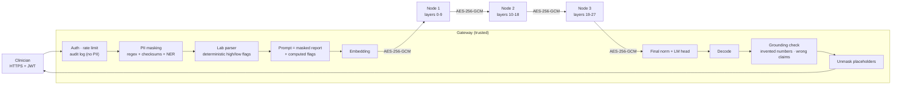

# secure-clinical-llm

[](https://github.com/yagmurtncr/secure-clinical-llm/actions/workflows/tests.yml)


**A privacy-preserving LLM assistant that explains Turkish lab reports, with the model split across several
on-premise machines.** Patient identifiers are removed before the model sees the text, no machine other than
the gateway ever sees tokens or output, and every answer is checked against the report before it is returned.

> Hospitals cannot send patient data to a cloud LLM, and they rarely have one GPU large enough for a 7-8B
> model. This project runs a strong open model (default: Qwen2.5-7B-Instruct) across ordinary machines, keeps
> identifiers inside a trusted gateway, and measures what that costs.

## How a request flows



<sub>Layer ranges shown for Qwen2.5-7B (28 layers, 3 nodes). The gateway relays the hidden state to each node in turn.</sub>

## Design decisions

| Decision | Why |
|---|---|
| **Gateway keeps embedding and LM head; nodes hold only middle layers** | No node ever sees token ids or logits, so none can read the prompt or the answer directly. |
| **Each node loads only its own tensors from safetensors** | A 3-node deployment needs ~1/3 of the weights per machine; nothing is unpickled. |
| **Per-node KV cache, keyed by session** | Decoding is incremental (O(1) new token per step per node) instead of re-running the whole prompt. |
| **Authenticated X25519 handshake + AES-256-GCM with counters** | Fresh keys per channel, tamper detection, replay and reflection rejection, and rogue machines without the cluster secret are refused. |
| **PII masked *before* embedding, restored *after* decoding** | Hidden states can be inverted, so identifiers must never enter the model. Placeholders like `[AD_1]` survive generation and are mapped back at the gateway. |
| **Lab flags computed in code and given to the model** | The model explains; it does not do range arithmetic. The ablation below measures the effect. |
| **Grounding check on every answer** | Flags numbers that are not in the report and high/low statements that contradict the reference range. |

Full threat model, including what this design does **not** protect against: [docs/THREAT_MODEL.md](docs/THREAT_MODEL.md).

## Results

All numbers below are reproducible with the scripts in [`eval/`](eval/); raw outputs are in [`results/`](results/).

### 1. Split inference is exact

The split pipeline is tested against the monolithic model for Llama and Qwen2 architectures with 1-3 shards:
logits match to 1e-5 and greedy outputs are token-identical, both in-process and over the encrypted HTTP
transport ([`tests/test_split.py`](tests/test_split.py), [`tests/test_transport.py`](tests/test_transport.py)).

### 2. PII detection (synthetic Turkish lab reports, 500 reports, 3,148 identifiers)

| Label | Regex + validators<br/>P / R / F1 | + Turkish BERT NER<br/>P / R / F1 |
|---|---|---|
| Name (`AD`) | 1.000 / 0.890 / 0.942 | 1.000 / 0.989 / 0.994 |
| T.C. Kimlik No | 1.000 / 1.000 / 1.000 | 1.000 / 1.000 / 1.000 |
| Phone | 1.000 / 1.000 / 1.000 | 1.000 / 1.000 / 1.000 |
| E-mail, IBAN, record no., birth date | 1.000 / 1.000 / 1.000 | 1.000 / 1.000 / 1.000 |
| **Micro average** | **1.000 / 0.951 / 0.975** | **1.000 / 0.995 / 0.997** |

The benchmark includes hard negatives (invalid 11-digit barcodes, device serial numbers that look like phone
numbers, sample dates, lab values). Error analysis drove two fixes: bare 10-digit numbers count as phones only
next to a phone keyword (precision 0.65 → 1.00), and a name found in a header field is masked everywhere it
recurs. Names that appear only in free text (e.g. a relative) need the NER model.
*Caveat:* the generator and the detector were written by the same person, so these numbers are an upper bound;
validation on de-identified real reports is the next step.

```bash
python eval/pii_benchmark.py --n 500            # regex + validators
python eval/pii_benchmark.py --n 500 --ner      # + akdeniz27/bert-base-turkish-cased-ner
```

### 3. Cost of splitting and encryption

Crypto micro-benchmark (pack + encrypt + decrypt + unpack, bf16 activations):

| Hidden size | One decode step | 512-token prefill |
|---|---|---|
| 3,584 (Qwen2.5-7B) | 0.017 ms (7 KB) | 2.5 ms (3.7 MB) |
| 4,096 (Llama-3.1-8B) | 0.016 ms (8 KB) | 2.8 ms (4.2 MB) |

End-to-end, Qwen2.5-0.5B-Instruct, 3 shards, 128-token prompt, 48 new tokens, 2-core CPU:

| Setup | Tokens / s |
|---|---|
| Monolithic `model.generate` | 9.6 |
| Split, in-process | 9.8 |
| Split, 3 HTTP nodes on localhost, encrypted | 8.4 (+17 ms / token) |

Encryption is negligible; the overhead is HTTP round trips (3 per token). A persistent binary stream
(gRPC / WebSocket) is the obvious next optimization.

```bash
python eval/split_overhead.py --model Qwen/Qwen2.5-0.5B-Instruct
```

### 4. Do computed flags reduce hallucination? (ablation)

Same pipeline, same 20 synthetic reports, with and without the computed-flags table in the prompt
(Qwen2.5-1.5B-Instruct, CPU smoke run):

| | With computed flags | Without (model reads ranges itself) |
|---|---|---|
| Answers containing a number not in the report | **0 %** (0 / 20) | 15 % (3 / 20) |
| Wrong high / low / normal claims | **0 / 72** | 4 / 9 (44 %) |
| Explicit, checkable status claims | 72 | 9 |

Without the flags the model rarely commits to a status, and when it does it is often wrong. *Caveat:* at this
size the model largely restates the flags table, so this run shows the guard works, not that the explanations
are good. The headline run uses the 7B model on a GPU (`results/grounding_*.json` records model, seed and
device for every run).

```bash
python eval/grounding_eval.py --model Qwen/Qwen2.5-7B-Instruct --n 50 --device cuda
```

## Quick start

**Single machine** (the model is split into shards in-process, full gateway pipeline):

```bash
pip install -e ".[test]"
python examples/demo_local.py --model Qwen/Qwen2.5-7B-Instruct --device cuda --ner
python examples/demo_local.py --model Qwen/Qwen2.5-1.5B-Instruct --dtype bfloat16   # CPU
```

**Three nodes + gateway** with Docker Compose:

```bash
cp .env.example .env        # fill in SCLLM_CLUSTER_SECRET and SCLLM_JWT_SECRET
docker compose up --build
export TOKEN=$(SCLLM_JWT_SECRET=... python scripts/issue_token.py --sub dr.demo)
curl -s localhost:8080/v1/analyze -H "Authorization: Bearer $TOKEN" \
     -H "Content-Type: application/json" \
     -d "{\"report\": $(python -c 'import json;print(json.dumps(open("examples/sample_report.txt").read()))')}"
```

The response contains the unmasked answer, the parsed labs with their flags, the grounding report, PII counts
and per-stage timings. For GPUs, set `SCLLM_DEVICE=cuda` and give each node service a GPU in the compose file.

**Tests:** `pytest -q` (41 tests: split exactness, safetensors shard loading, channel security, PII, lab
parsing, grounding, API auth / rate limit / audit).

## Repository layout

```text
src/scllm/
  split/       partitioning, shard loading from safetensors, pipeline runtime with per-node KV cache
  transport/   X25519 + AES-256-GCM channel, node server, remote-stage client
  pii/         Turkish PII detectors (checksums, field patterns, optional NER) and reversible masking
  clinical/    lab-row parser and flags, prompt, grounding checks
  api/         FastAPI gateway, JWT, rate limiting, PII-free audit log
eval/          PII benchmark, overhead benchmark, grounding ablation
docs/          threat model
examples/      sample report and single-machine demo
```

## Limitations

Research prototype, not a medical device and not audited for KVKK / GDPR / HIPAA compliance. Hidden states
can leak the (masked) text to a curious node; nodes are trusted not to tamper with activations; PII recall on
real reports is untested. See [docs/THREAT_MODEL.md](docs/THREAT_MODEL.md).

## Background

This repository consolidates three earlier prototypes into one system:
[`ModelDistributedInference`](https://github.com/yagmurtncr/ModelDistributedInference) (layer partitioning and
encrypted node communication), [`dsi`](https://github.com/yagmurtncr/dsi) (3-node deployment, Turkish PII
masking, RBAC) and [`privacy-preserving-medical-llm`](https://github.com/yagmurtncr/privacy-preserving-medical-llm)
(the clinical lab-report use case). It was rewritten around exactness tests, measured overhead and an
explicit threat model.

## License

MIT
