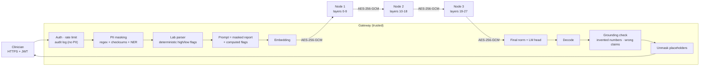

# secure-clinical-llm

[](https://github.com/yagmurtncr/secure-clinical-llm/actions/workflows/tests.yml)


**A privacy-preserving LLM assistant that explains Turkish lab reports, with the model split across several
on-premise machines.** Patient identifiers are removed before the model sees the text, no machine other than
the gateway ever sees tokens or output, and every answer is checked against the report before it is returned.
Every claim below is backed by a test or a reproducible experiment, including the ones that show where the
design stops protecting you.

> Hospitals cannot send patient data to a cloud LLM, and they rarely have one GPU large enough for a 7-8B
> model. This project runs a strong open model (default: Qwen2.5-7B-Instruct) across ordinary machines, keeps
> identifiers inside a trusted gateway, and measures what that costs.

## How a request flows



<sub>Layer ranges shown for Qwen2.5-7B (28 layers, 3 nodes). The gateway relays the hidden state to each node in turn.</sub>

## Design decisions

| Decision | Why |
|---|---|
| **Gateway keeps embedding and LM head; nodes hold only middle layers** | No node ever sees token ids or logits. This is *not* confidentiality on its own: experiment 3 shows hidden states can be read back almost completely. |
| **Each node loads only its own tensors from safetensors** | A 3-node deployment needs ~1/3 of the weights per machine; nothing is unpickled. |
| **Per-node KV cache, keyed by session** | Decoding is incremental (O(1) new token per step per node) instead of re-running the whole prompt. |
| **Authenticated X25519 handshake + AES-256-GCM with counters** | Fresh keys per channel, tamper detection, replay and reflection rejection, and rogue machines without the cluster secret are refused. |
| **PII masked *before* embedding, restored *after* decoding** | Because hidden states are invertible (measured below), identifiers must never enter the model. Placeholders like `[AD_1]` survive generation and are mapped back at the gateway. |
| **Lab flags computed in code and given to the model** | The model explains; it does not do range arithmetic. The ablation below measures the effect. |
| **Grounding check on every answer** | Flags numbers that are not in the report and high/low statements that contradict the reference range. |

Full threat model, including what this design does **not** protect against: [docs/THREAT_MODEL.md](docs/THREAT_MODEL.md).

## Results

All numbers below are reproducible with the scripts in [`eval/`](eval/); raw outputs are in [`results/`](results/).

### 1. Split inference is exact

The split pipeline is tested against the monolithic model for Llama and Qwen2 architectures with 1-3 shards:
logits match to 1e-5 and greedy outputs are token-identical, both in-process and over the encrypted HTTP
transport ([`tests/test_split.py`](tests/test_split.py), [`tests/test_transport.py`](tests/test_transport.py)).

### 2. PII detection

Exact-span precision / recall / F1, 95% bootstrap CI over reports. Two synthetic sets: the **standard** set
(500 lab reports, 3,148 identifiers, with hard negatives such as invalid 11-digit barcodes and device serials
that look like phone numbers) and a **stress** set (300 reports, 995 identifiers) built from formats the
detector was not designed around: unseen field labels, upper / lower-case names, "Sayın ..." salutations,
spaced ID numbers, identifiers inside running sentences, relatives named only in free text.

| Set | Regex + validators | + Turkish BERT NER |
|---|---|---|
| Standard, micro F1 | 0.975 [0.971, 0.978] | **0.997 [0.996, 0.999]** |
| Standard, names (`AD`) recall | 0.890 | 0.989 |
| Stress, micro F1 - *first run* | 0.532 [0.508, 0.558] | - |
| Stress, micro F1 - after fixes | 0.870 [0.861, 0.880] | **0.987 [0.979, 0.993]** |
| Stress, names (`AD`) recall - after fixes | 0.558 | 0.965 |

T.C. Kimlik No, phone, e-mail, IBAN, record numbers and birth dates are at 1.000 precision and recall on the
standard set. The stress set did its job: its first run exposed spaced ID numbers (recall 0.49), unseen labels
(`İsim:`, `Adı:`), salutations and upper-case names; the fixes (grouped-ID pattern with checksum, new labels,
salutation rule, Turkish case-folded propagation of a found name to the rest of the report) took regex-only F1
from 0.53 to 0.87. Names that appear only in free text still need the NER model.
*Caveat:* both sets are synthetic and written by the author of the detector; treat them as regression tests
and an upper bound, not as performance on real hospital reports.

```bash
python eval/pii_benchmark.py --n 500 [--ner]                 # standard
python eval/pii_benchmark.py --n 300 --hard --seed 3 [--ner] # stress
```

### 3. How much does a curious node see? (hidden-state leakage)

A node receives hidden states, not text. How much text can it reconstruct? Qwen2.5-0.5B-Instruct (24 layers),
token recovery accuracy on 40 held-out reports (11,567 tokens). The attacker trains a ridge regression from
hidden state to input embedding on 100 reports it generated itself; **train and test use disjoint name lists**,
so the name column measures names the attacker has never seen.

| Hidden state after layer | Nearest embedding, no training (all tokens) | Linear probe (all tokens) | Linear probe (unseen name tokens) |
|---|---|---|---|
| 0 (raw embedding) | 1.000 | 0.993 | 0.842 |
| 1 | 0.001 | 0.975 | 0.418 |
| 4 | 0.000 | 0.973 | 0.373 |
| 8 (shard boundary) | 0.000 | 0.972 | 0.358 |
| 16 (shard boundary) | 0.000 | 0.973 | 0.388 |
| 23 | 0.001 | 0.963 | 0.273 |

**A simple linear attacker reads back ~97% of the report from any node, at any depth**, and about a third of the
tokens of names it never trained on. Splitting the model is a deployment measure (pool small GPUs, no node
holds tokens or answers), not a privacy mechanism. This is the measured reason the design masks identifiers
*before* embedding and treats nodes as trusted on-premise infrastructure; see the
[threat model](docs/THREAT_MODEL.md).

```bash
python eval/hidden_state_leakage.py --model Qwen/Qwen2.5-0.5B-Instruct --train 100 --test 40
```

### 4. Cost of splitting and encryption

Crypto micro-benchmark (pack + encrypt + decrypt + unpack, bf16 activations):

| Hidden size | One decode step | 512-token prefill |
|---|---|---|
| 3,584 (Qwen2.5-7B) | 0.017 ms (7 KB) | 2.5 ms (3.7 MB) |
| 4,096 (Llama-3.1-8B) | 0.016 ms (8 KB) | 2.8 ms (4.2 MB) |

End-to-end, Qwen2.5-0.5B-Instruct, 3 shards, 128-token prompt, 48 new tokens, 2-core CPU:

| Setup | Tokens / s |
|---|---|
| Monolithic `model.generate` | 9.6 |
| Split, in-process | 9.8 |
| Split, 3 HTTP nodes on localhost, encrypted | 8.4 (+17 ms / token) |

Encryption is negligible; the overhead is HTTP round trips (3 per token). A persistent binary stream
(gRPC / WebSocket) is the obvious next optimization.

```bash
python eval/split_overhead.py --model Qwen/Qwen2.5-0.5B-Instruct
```

### 5. Can the grounding checker be trusted?

Before using the checker as a metric, it was tested on answers with known injected errors (400 reports,
`eval/checker_validation.py`). Paraphrases are split into a *dev* set (used once to extend the keyword list)
and a *held-out* set written beforehand and never used for tuning.

| | Flagged |
|---|---|
| Correct answers (false positives), all phrasings | **0.0 %** |
| Invented number | 99.0 % |
| Wrong high/low claim, standard phrasing | 100 % |
| Wrong claim, dev paraphrases | 3.5 % → 78.2 % after extending the lexicon |
| Wrong claim, held-out paraphrases | **0 %** |

The checker never raises false alarms and reliably catches invented numbers, but a keyword lexicon does not
generalize to unseen phrasings: a contradiction worded differently goes unnoticed. Results in section 6
therefore count only claims the checker can parse, and an NLI-based checker is the next step.

### 6. Do computed flags reduce hallucination? (ablation)

Same pipeline, same 50 synthetic reports, with and without the computed-flags table in the prompt
(Qwen2.5-1.5B-Instruct on CPU, greedy decoding, 160 new tokens). 95% intervals from a paired bootstrap over
reports (`results/grounding_qwen1.5b_cpu_n50.json`).

| | With computed flags | Without (model reads ranges itself) |
|---|---|---|
| Wrong high / low / normal claims | **0 / 130** (≤ 2.3 %, rule of three) | 8 / 22 = 36 % [29 %, 50 %] |
| Checkable status claims per answer | **2.6** [2.1, 3.1] | 0.44 [0.14, 0.78] |
| Answers containing a number not in the report | 6 % [0 %, 14 %] | 18 % [8 %, 30 %] |

What the data supports: with the flags the model states a status for ~6x more results and none of those
statements is wrong; without them, about a third of the few statements it makes are wrong. The drop in
invented numbers points the same way but is **not significant at n = 50** (difference -12 points,
CI [-26, +2]). Two caveats: the checker only parses standard phrasings (section 5), and at 1.5B the model
partly restates the flags table, so this measures the guard, not explanation quality. The 7B GPU run is the
next step.

```bash
python eval/grounding_eval.py --model Qwen/Qwen2.5-7B-Instruct --n 50 --device cuda
```

## Quick start

**Single machine** (the model is split into shards in-process, full gateway pipeline):

```bash
pip install -e ".[test]"
python examples/demo_local.py --model Qwen/Qwen2.5-7B-Instruct --device cuda --ner
python examples/demo_local.py --model Qwen/Qwen2.5-1.5B-Instruct --dtype bfloat16   # CPU
```

**Three nodes + gateway** with Docker Compose:

```bash
cp .env.example .env        # fill in SCLLM_CLUSTER_SECRET and SCLLM_JWT_SECRET
docker compose up --build
export TOKEN=$(SCLLM_JWT_SECRET=... python scripts/issue_token.py --sub dr.demo)
curl -s localhost:8080/v1/analyze -H "Authorization: Bearer $TOKEN" \
     -H "Content-Type: application/json" \
     -d "{\"report\": $(python -c 'import json;print(json.dumps(open("examples/sample_report.txt").read()))')}"
```

The response contains the unmasked answer, the parsed labs with their flags, the grounding report, PII counts
and per-stage timings. For GPUs, set `SCLLM_DEVICE=cuda` and give each node service a GPU in the compose file.

**Tests:** `pytest -q` (46 tests, including property-based tests with Hypothesis: mask/unmask is lossless
for arbitrary surrounding text, detector spans never overlap, every layer is assigned to exactly one shard,
encrypted frames round-trip for random shapes and dtypes; plus split exactness, safetensors shard loading,
channel security, lab parsing, grounding and API auth / rate limit / audit).

## Repository layout

```text
src/scllm/
  split/       partitioning, shard loading from safetensors, pipeline runtime with per-node KV cache
  transport/   X25519 + AES-256-GCM channel, node server, remote-stage client
  pii/         Turkish PII detectors (checksums, field patterns, optional NER) and reversible masking
  clinical/    lab-row parser and flags, prompt, grounding checks
  api/         FastAPI gateway, JWT, rate limiting, PII-free audit log
eval/          PII benchmark (+ stress set), hidden-state leakage, overhead, checker validation, grounding ablation
docs/          threat model
examples/      sample report and single-machine demo
```

## Limitations

Research prototype, not a medical device and not audited for KVKK / GDPR / HIPAA compliance. Hidden states
leak the (masked) report to a curious node (section 3); nodes must be trusted on-premise machines; PII recall
on real reports is untested; the grounding checker misses unseen paraphrases (section 5). See [docs/THREAT_MODEL.md](docs/THREAT_MODEL.md).

## Background

This repository consolidates three earlier prototypes into one system:
[`ModelDistributedInference`](https://github.com/yagmurtncr/ModelDistributedInference) (layer partitioning and
encrypted node communication), [`dsi`](https://github.com/yagmurtncr/dsi) (3-node deployment, Turkish PII
masking, RBAC) and [`privacy-preserving-medical-llm`](https://github.com/yagmurtncr/privacy-preserving-medical-llm)
(the clinical lab-report use case). It was rewritten around exactness tests, measured overhead and an
explicit threat model.

## License

MIT
