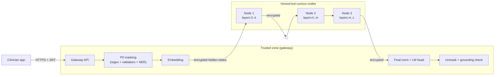

# Threat model

## Setting

A hospital wants LLM explanations of lab reports without sending patient data to an external API, and
without a single large GPU server. The model is split across several on-premise machines ("nodes"); a
gateway inside the hospital network talks to clinicians and to the nodes.

The gateway sends the hidden state to each node in turn and receives the result back (the diagram shows the
logical order).

## Assets

| Asset | Where it exists in clear text |
|---|---|
| Patient identifiers (name, T.C. Kimlik No, phone, e-mail, IBAN, record numbers, birth date, address) | Gateway only. Replaced by placeholders before embedding; the mapping never leaves the gateway process. |
| Report text after masking | Gateway only (token ids never leave it). |
| Intermediate activations (hidden states) | Inside each node, for its own layers. |
| Model answer | Gateway only (logits are computed by the gateway). |
| Model weights | Open weights; each node holds only its own layers. |

## Adversaries and what each one gets

| Adversary | Capability | What protects the data |
|---|---|---|
| Network observer between gateway and nodes | Reads / modifies / replays traffic | AES-256-GCM with per-channel keys from an authenticated X25519 handshake; strictly increasing counters reject replay and reordering; tampering fails the GCM tag. |
| Rogue machine pretending to be a node or the gateway | No cluster secret | Handshake is authenticated with an HMAC keyed by the cluster secret; it cannot complete. |
| Curious node operator | Sees hidden states of its own layers | Never sees token ids, PII values or output logits. **Can** try to invert hidden states back into text (see limitations) - which is why PII is removed *before* embedding. |
| Curious log reader | Reads the audit log | Audit log stores only a hash of the report, PII *counts*, timing and the user id. |
| Unauthorized API user | No valid token | JWT (HS256, audience + expiry required), role check, per-user rate limit, input size limit. |

## Known limitations (stated on purpose)

* **Hidden-state inversion (measured).** A ridge-regression attacker trained on self-generated reports recovers
  ~97% of input tokens from the hidden state at *every* layer of Qwen2.5-0.5B, and ~27-42% of tokens of names it
  never saw (README, section 3). Keeping the first few layers on the gateway does not help. Split inference is
  therefore a *deployment* measure, not a confidentiality mechanism: nodes must be trusted on-premise machines,
  and what a node could reconstruct must be limited to the masked report - which is why masking happens first.
* **PII detection is not perfect.** Recall on the synthetic benchmark is high but real reports are messier;
  free-text names rely on the NER model. Missed identifiers would reach the nodes as hidden states.
* **Nodes are assumed honest-but-curious.** A malicious node can return wrong activations and corrupt the
  answer. The grounding check catches some consequences (invented numbers, wrong high/low claims), not all.
* **No formal compliance claim.** This is a research prototype. It implements controls that KVKK / GDPR
  guidance asks for (data minimization, access control, audit trail, encryption in transit) but it has not
  been audited.
* **TLS for the public API** is expected to be terminated by the hospital's reverse proxy.

## Possible extensions

Running nodes in confidential-computing enclaves (e.g. GPU TEEs), adding noise / dimensionality reduction to
transmitted activations and measuring inversion attack success against it, and signing node responses.
